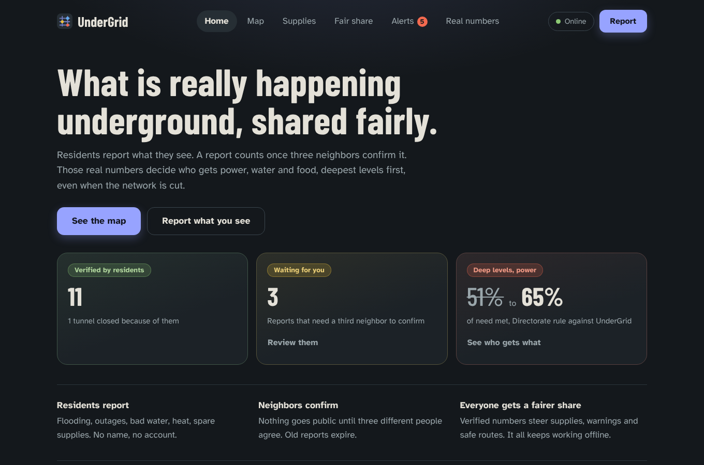
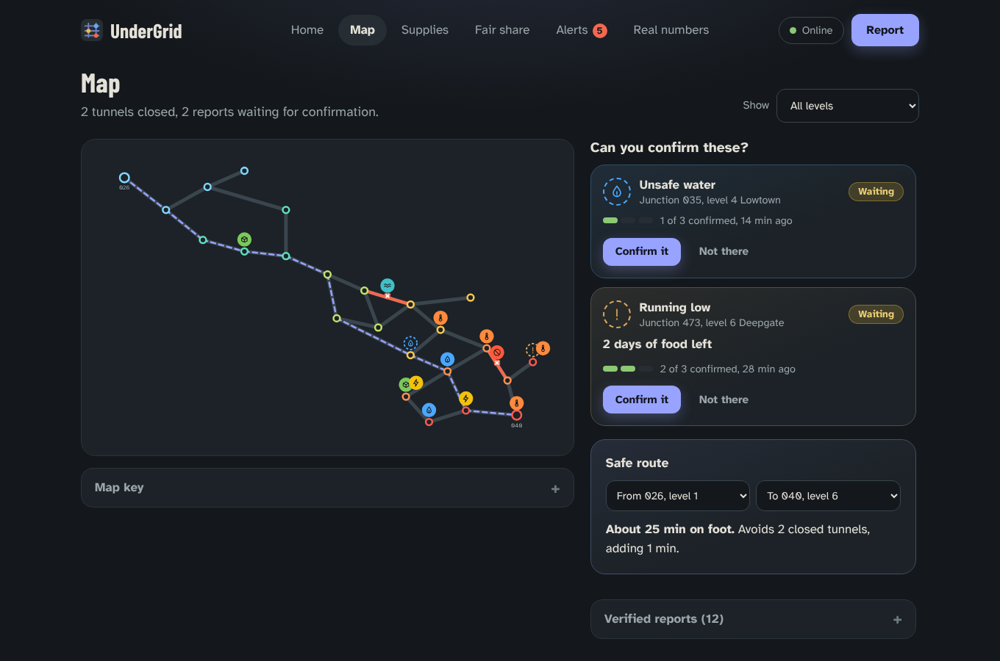
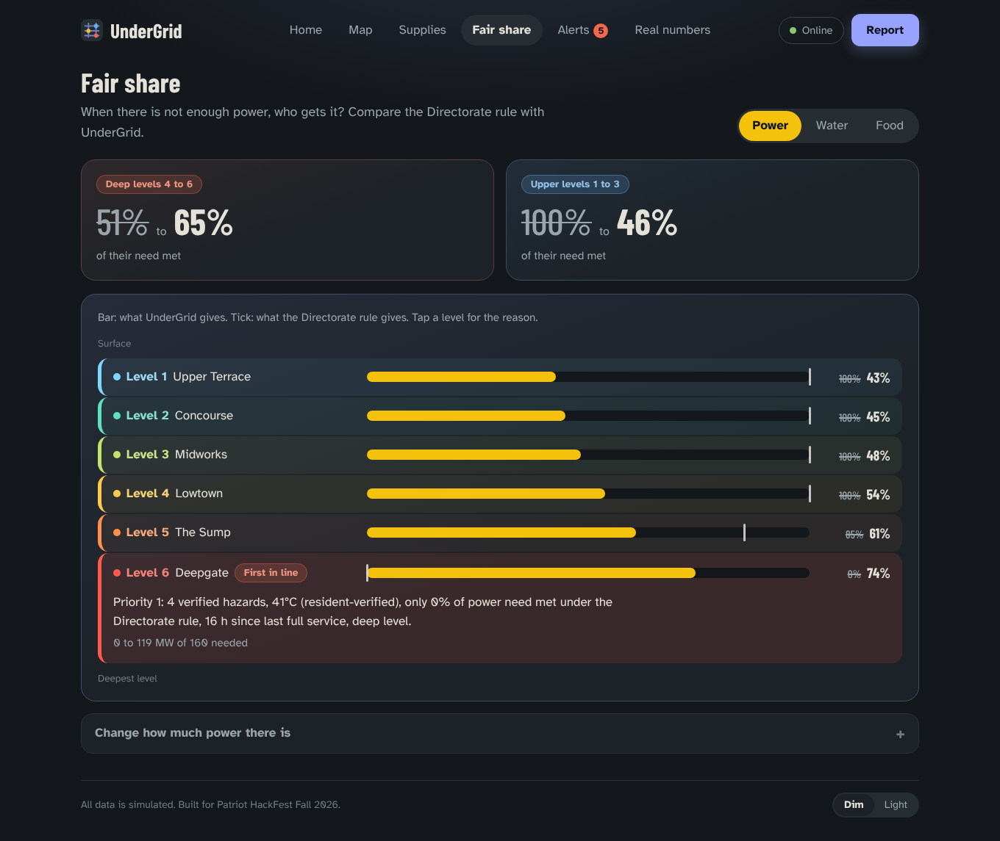

# UnderGrid

**Live app: https://undergridai.onrender.com**

UnderGrid is a crowdsourced survival grid for people living underground. Residents report what they actually see: floods, outages, bad water, heat, spare supplies. A report only goes public once three different people confirm it. Those confirmed numbers then decide how power, water and food get shared (deepest levels first), when to warn people, and which tunnels are safe to walk. It keeps working when the network is cut.

Built for Patriot HackFest Fall 2026, track *Life Underground*, route *Sustainability Underground*.



| Map | Fair share |
|---|---|
|  |  |

## Try it

Open **https://undergridai.onrender.com** on any phone or computer. No install, no account. Send a report on one device and it shows up on the others within a few seconds. Have two or three people confirm it and it turns verified.

- The server runs on a free plan, so the first load after it's been idle can take about 30 seconds.
- **Desktop-style options:** Chrome and Edge offer "Install UnderGrid" in the address bar. `UnderGrid.html` (in the repo) is the same app as a single file you can double-click. It already points at the live server, so it syncs on its own and still works with no internet.
- **Network screen** (tap the status pill): shows who's connected and has a switch that simulates the Directorate cutting the network. Reports made while cut off are saved and sent when you reconnect.

## What's in it

| Screen | What it does |
|---|---|
| Home | The headline numbers and the two things you'll do most: report and check the map. |
| Map | The tunnel network. Verified floods and blockages close tunnels, and the route planner goes around them. |
| Supplies | What people are sharing, who's running low, and the nearest supply you can reach safely. |
| Fair share | One bar per level showing what UnderGrid allocates against what the Directorate rule would. Tap a level for the reason. |
| Alerts | Early warnings for blackouts, unsafe water, heat and closed tunnels, each with a "why". |
| Real numbers | The Directorate's figures next to what residents verified. |

This covers the Group A questions on sharing power, water and food fairly (main focus), heat in the lower levels, early warnings, unsafe water, tunnel safety, and communicating when the network is down.

## How trust works

- A report is unverified until 3 different devices confirm it. The reporter counts as the first.
- Each device gets one vote per report and can't vote on its own.
- Reports expire (floods after 6 hours, blockages after 24).
- Each device can send at most 12 events per 10 minutes.
- Only verified reports feed the allocation, alerts and real numbers.
- Devices are random IDs. Nothing personal is collected.

## How fair share works

Both rules are computed side by side for each resource. The **Directorate rule** serves upper levels in full first. The **UnderGrid rule** gives every level at least 40% of its need, then splits the rest by population and need, capped at demand. Need combines shortfall, heat, depth, verified hazards and time since last service. At the default settings, power coverage for levels 4 to 6 goes from 51% to 65%, while levels 1 to 3 drop from 100% to 46%. The app says plainly what the upper levels give up. The weights are in `web/src/engine/allocation.ts`.

## How it works

Every device runs the same logic on a shared, append-only list of reports and votes. Events are merged by ID, so it doesn't matter what order they arrive in, and every device ends up with the same picture. Devices store this list locally (IndexedDB) so the app loads and works offline. A small Node server collects events and hands each device what it hasn't seen yet. Offline sync between nearby devices is simulated with browser tabs.

```
web/src/engine/      verification, routing, allocation, alerts (+ tests)
web/src/store/       local storage, sync, peer mesh
web/src/components/  one file per screen
server/index.js      the sync server (Express)
desktop/             optional Electron desktop app
docs/                demo script, Devpost text, plan, screenshots
```

## Run it yourself

You only need this if you want your own copy. Use Node 22 LTS.

```bash
npm install
npm run build
npm start              # http://localhost:3001
npm run start:lan      # same, but friends on your Wi-Fi can join
npm test               # 19 engine tests
```

- **Deploy:** connect the repo to Render as a Web Service. `render.yaml` has the settings.
- **Single file:** `npm run build:single` makes `UnderGrid.html`. Add `VITE_DEFAULT_SERVER=https://your-server` in front to point it at your server.
- **Desktop app:** `npm run desktop` opens it in its own window. `npm run dist:desktop` builds an installer for your OS.
- **Install trouble on Windows?** Use Node 22, delete `node_modules` and `package-lock.json`, and keep the project outside OneDrive.

## Limits

- All data is simulated. Levels, populations, temperatures and the Directorate's figures are made up.
- The tunnel map is a simplified sketch inspired by a GMU campus sewer map, not real infrastructure data.
- The server keeps events in a JSON file, which is fine for a demo, not for scale.
- Verification stops casual spam but not a large coordinated group. A real system would need stronger device trust.
- Alert warning times are estimates and labeled that way in the app.

